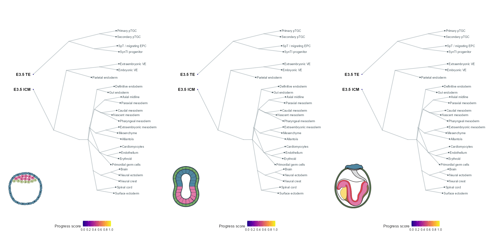

<h1>🧬 Embryo Model Benchmarking Framework </h1>

  

This repository provides example code for mapping single-cell transcriptomic datasets onto the **MouseRef reference atlas** and **URD developmental tree**, enabling cell-type annotation, developmental stage prediction, and comparative analysis of embryo models.

For GAN scoring, please refer to our separate repository: https://github.com/WHu1995/GAN-scoring

For transcription factor perturbation analysis, please refer to our separate repository: https://github.com/WHu1995/tf_perturbation_model

## 🚀 Workflow

### Step 1 — Build and Visualize MouseRef (Optional)

You can either construct the MouseRef reference atlas from scratch or download the precomputed reference:

📥 **[Download MouseRef from Zenodo](https://zenodo.org/records/22019550)**

**Build the reference atlas**

`01_Build Mouseref(optional).R`

- Example code for constructing MouseRef from scratch.
- Includes preprocessing, integration, and dimensionality reduction.
- This step can be skipped if you use the precomputed reference.

**Visualize the reference atlas**

`01_Mouseref_visualization.R`

- Load the precomputed MouseRef object.
- Generate UMAP visualizations and marker gene expression plots.
- This step is optional if you are using your own reference atlas.

---

### Step 2 — Project Query Data onto MouseRef (Label Transfer)

**Script:** `02_Project_to_Mouseref_UMAP.R`

This step maps your query dataset onto the MouseRef reference atlas.

- Performs reference-based mapping using `FindTransferAnchors` and `MapQuery`.
- Transfers cell-type and developmental stage annotations.
- Projects query cells onto the reference UMAP for visualization and comparison.

---

### Step 3 — Project Query Data onto the URD Tree

You can use the preconstructed URD developmental tree or build your own tree using the provided example code.

📥 **[Download the precomputed URD tree from Zenodo](https://zenodo.org/records/23484968)**

**Build your own URD tree (Optional)**

`03_Build_your_own_tree(optional).R`

- Provides example code for constructing a URD developmental tree using MouseRef.
- Can be used as a reference for building a tree from your own dataset.
- **Note:** Tree layout parameters should be adjusted according to the structure of your own URD tree.

**Project query data onto the URD tree**

`03_project_to_URDtree.R`

- Projects query cells onto the reference developmental tree.
- Enables visualization of query cell distributions along developmental trajectories.
- Facilitates comparisons of developmental progression between embryo models and the natural embryo reference.

---

····································································

Session info:
R and R packages:
R version 4.4.1
batchelor: 1.22.0
Seurat: 4.4.0
SeuratObject: 5.2.0
SingleCellExperiment: 1.28.1
scuttle: 1.16.0
Matrix: 1.7-0
matrixStats: 1.4.1
ggplot2: 3.5.1
dplyr: 1.1.4
RColorBrewer: 1.1-3
ggalluvial: 0.12.5
scRNAtoolVis: 0.1.0

Python:
python: 3.10.20
pandas: 2.3.3
numpy: 2.2.6
keras: 3.12.1
torch: 2.10.0+cu128
sklearn: 1.7.2
matplotlib: 3.10.8

